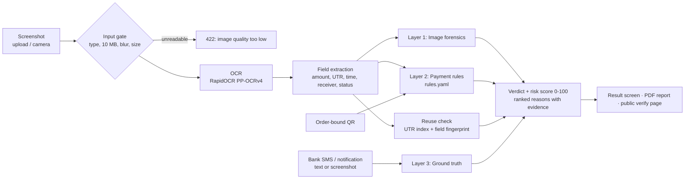

<div align="center">

# Pramaan

**Check a UPI payment screenshot before you hand over the goods.**

A mobile-first web app that helps small Indian shopkeepers catch fake and reused payment screenshots,
with a clear verdict and the reasons behind it.

[](https://nextjs.org)
[](https://fastapi.tiangolo.com)
[](https://python.org)
[](#tests)
[](#quick-start)
[](#)

</div>

> A screenshot alone cannot prove a payment. Pramaan never says "100% genuine" from pixels. The only way to
> reach **CONFIRMED** is a match against the shopkeeper's own bank SMS.

## Contents

- [Verdicts](#verdicts)
- [Quick start](#quick-start)
- [Deploy for free](#deploy-for-free)
- [How it works](#how-it-works)
- [Benchmark](#benchmark-synthetic-our-own-data)
- [REST API](#rest-api)
- [Privacy](#privacy)
- [Configuration](#configuration)
- [Tests](#tests)
- [Project layout](#project-layout)
- [Limitations](#limitations)

## Verdicts

| Verdict | Meaning | What the shopkeeper is told |
| --- | --- | --- |
| **CONFIRMED** | Bank credit SMS matches the screenshot's UTR and amount | You can hand over goods. |
| **LIKELY GENUINE** | No problems found, but not confirmed with the bank | Check your bank SMS or soundbox first. |
| **SUSPICIOUS** | Inconsistencies, or the image is too degraded to trust | Do not hand over goods yet. Confirm in your bank app. |
| **LIKELY FAKE** | Edited fields, wrong receiver, dummy UTR, reused proof | Do not hand over goods. Confirm in your bank app. |

Built for Parakram Hackathon problem statement **CS-01: Fake Payment Screenshot and Transaction Verification**.

## Quick start

**Docker (one command)**

```bash
docker compose up --build
```

**Without Docker** (Python 3.11 and Node 18+; the script installs dependencies on first run)

```bash
./start.sh            # macOS / Linux / Git Bash
.\start.ps1           # Windows PowerShell
```

Then open:

- Web app: <http://localhost:3000>. Sign in with the demo account **merchant@pramaan.local / shopkeeper123**, or create your own.
- API docs (Swagger): <http://localhost:8000/docs>
- Benchmark: <http://localhost:3000/benchmark>

On first start the backend creates the demo merchant and runs about 24 mock receipts through the real pipeline,
so the dashboard has history. This runs in the background and takes a minute or two.

<details>
<summary>Manual start (two terminals)</summary>

```bash
# Terminal 1: API
cd backend
python3.11 -m venv .venv && source .venv/bin/activate   # Windows: .venv\Scripts\activate
pip install -r requirements.txt
uvicorn app.main:app --port 8000 --timeout-keep-alive 75

# Terminal 2: web
cd frontend
npm ci
npm run dev
```

To open the app from a phone on the same Wi-Fi, browse to `http://<your-computer-ip>:3000`. The web app proxies
`/api/*` to the backend, so the phone only needs port 3000.
</details>

### Try it in two minutes

1. Sign in with the demo account. On **Verify**, pick a **mock test receipt**. Start with *Unedited receipt*: it comes
   back LIKELY GENUINE with "not confirmed" wording.
2. Press **Confirm with bank SMS**, then **Insert sample SMS**. The verdict becomes CONFIRMED.
3. Try *Same receipt again*. It is the previous screenshot, cropped and re-compressed, and it is caught as **reused proof**
   with a link to the first check.
4. Try *Edited amount* and *Wrong receiver*. Open the heatmap and press **Show on image** next to a reason.
5. **Order QR**: create a ₹640 QR, then verify a receipt against that order.
6. **Dashboard**: history, filters, UTR search and estimated rupees saved. **Download report** gives a PDF whose QR
   opens a public record of the check.

## Deploy for free

Everything (API and web app) deploys to **Render** from the [`render.yaml`](render.yaml) blueprint in one go:

1. Sign in at <https://render.com> with GitHub.
2. **New + -> Blueprint**, pick your repository (`Pramaan-v3`), and click **Apply**.
3. Render creates both services:
   - `pramaan-api` (Docker backend)
   - `pramaan-web` (Next.js frontend)
4. When both services go live, copy their public URLs (e.g. `https://pramaan-web-xxxx.onrender.com` and `https://pramaan-api-xxxx.onrender.com`).
5. Open the `pramaan-web` URL and sign in with:
   - **Email:** `merchant@pramaan.local`
   - **Password:** `shopkeeper123`

### Automatic Keep-Awake Cron Job (Prevent Free-Tier Sleep)

Render free-tier web services spin down and sleep after 15 minutes of inactivity. To keep your app awake 24/7 without delays:

#### Method 1: Automatic GitHub Actions Cron (Recommended)
This repository includes an automatic scheduled cron job in [`.github/workflows/keep-awake.yml`](.github/workflows/keep-awake.yml) that triggers every 10 minutes:
1. Go to your GitHub repository -> **Settings** -> **Secrets and variables** -> **Actions** -> **Variables** tab.
2. Add a new repository variable:
   - Name: `RENDER_WEB_URL`
   - Value: `https://your-pramaan-web-url.onrender.com`
   - (Optional) Name: `RENDER_API_URL`
   - Value: `https://your-pramaan-api-url.onrender.com`
3. The workflow runs every 10 minutes on a cron schedule (`*/10 * * * *`) and pings the health endpoints so your service never sleeps.
4. You can also trigger it manually anytime under the **Actions** tab -> **Keep Render Awake** -> **Run workflow**.

#### Method 2: Free External Cron (cron-job.org or UptimeRobot)
For 0-jitter, guaranteed 5-minute pings:
1. Create a free account at [cron-job.org](https://cron-job.org) or [UptimeRobot](https://uptimerobot.com).
2. Create a new monitor/cron job targeting:
   - `https://your-pramaan-web.onrender.com/api/health`
3. Set the interval to **every 5 or 10 minutes**. This keeps both web and backend active permanently at zero cost.

---

## How it works



### Layer 1: image forensics (`backend/app/services/forensics.py`)

Screenshots are flat, single-pass renders. Phone photo editors break that, mostly around the fields people edit.

| Check | What it catches |
| --- | --- |
| File metadata | Editor names in EXIF / PNG text (Photoshop, PicsArt, Snapseed, Canva...), and shapes that are not a phone screen |
| JPEG quality estimate | Heavy re-compression, which hides edits. Flagged as SUSPICIOUS rather than guessed through |
| Background around each key field | A painted-over patch whose colour differs slightly from its surroundings (amount, UTR, date, receiver) |
| Text consistency per field | Retyped text: different ink colour, misaligned with the other details, noise unlike the rest of the screen |
| Error level analysis (local) | Areas that re-compress differently from the rest. Shown as a heatmap with suspect regions boxed |
| Copy-move (block matching) | Pixel-identical patches copied elsewhere in the image (outside text; see limitations) |

### Layer 2: payment rules (`backend/app/rules.yaml`, `rules_engine.py`)

Config-driven, with one block per app (Google Pay, PhonePe, Paytm, BHIM, other). Adding an app means adding a
YAML block. Checks:

- UTR/reference format is checked (PhonePe's `T` + digits format can be inferred even when its logo is not OCR-readable); an unfamiliar format is a warning, not proof of forgery
- Amount in digits matches amount in words (OCR-merged words like `RupeesSixThousand` are handled)
- Receiver UPI ID is compared with the merchant's registered UPI ID. A mismatch is a critical merchant-safety finding, but it does not by itself prove the screenshot image was edited
- Transaction time is not in the future and not older than the merchant's allowed window
- The phone's status-bar clock is not *earlier* than the transaction time
- Status reads as success (failed / pending / processing are CRITICAL)
- Low OCR confidence on amount or UTR, and a simple layout template (amount position and centring, status line order, header colour for known apps)
- Order-bound QR: the receipt must show the order reference, or at least the order amount

Merchant **strictness** (lenient / standard / strict) moves the score thresholds. Strong contradictions and reused UTRs can produce **LIKELY FAKE**. Receiver mismatch, an old receipt, OCR uncertainty and pixel-forensics findings are not independently treated as proof that the image was forged; they produce warnings and must be checked against the bank record.

**Testing real receipts:** choose **Editing check only** to examine whether a screenshot appears altered regardless of receiver. **Payment to my shop** additionally checks the logged-in merchant's registered UPI ID and time window. A clean-looking screenshot is still not proof money arrived; only a matching bank SMS/statement can confirm that.

### Layer 3: ground truth (`sms_parser.py`)

The shopkeeper pastes the bank credit SMS or UPI notification, or uploads a screenshot of it, which is OCR'd.
Pramaan parses the amount, UTR, masked account and bank:

- UTR **and** amount match → **CONFIRMED**
- Same UTR, different amount → CRITICAL (the amount on the screenshot was edited)
- Different UTR, a debit SMS, or no UTR → not confirmed, with the reason
- A UTR that was already used in an earlier check can never be confirmed again, so one credit cannot cover two orders

### Reuse detection (`duplicate_detector.py`)

Every check stores the UTR and a 256-bit perceptual fingerprint of the payment-specific fields (amount, time,
sender, receiver). Status bars and borders are excluded, so cropping and re-compression don't hide a reuse.
The UTR is left out of the fingerprint, so a reused screenshot with an edited UTR still matches. On our mock
receipts, a cropped, re-compressed and 75%-scaled copy measures 12-18 bits from the original, and different
payments measure 34 or more. Matches are reported with when the proof was first seen, and whether it was at this
shop or another Pramaan merchant (other shops' check IDs are not revealed).

### Score

Each finding carries a penalty. Penalties are summed per layer (forensics capped at 70) and the total is capped at
100. The result screen lists every finding, most severe first, with its layer, a plain-language explanation and a
**Show on image** link to the heatmap or the highlighted field. It also lists every check that passed.

---

## Benchmark (synthetic, our own data)

`scripts/generate_dataset.py` renders **40 generic, brand-free MOCK receipts**, each with a visible "MOCK RECEIPT"
footer: 20 clean, and 20 with scripted, seeded tamper operations:

| Tamper type | n | Operation |
| --- | --- | --- |
| edited_amount | 3 | Amount painted over and retyped; words left unchanged |
| edited_utr | 3 | UTR retyped: 11 digits, dummy sequence, or plausible number in a slightly different font |
| edited_date | 3 | Date moved into the future, an old receipt re-dated, or time moved past the phone clock |
| cloned_digits | 3 | Copy-move of digits inside the amount and UTR |
| pasted_receiver | 3 | Receiver UPI ID pasted over |
| heavy_compression | 3 | Careful amount + words edit, then JPEG quality 18-30 |
| editor_software | 2 | Edited and saved by a photo editor (metadata) |

```bash
python scripts/generate_dataset.py      # writes backend/storage/dataset
python scripts/evaluate_benchmark.py    # prints precision, recall, confusion matrix; feeds /benchmark
```

Positive class = tampered. A sample counts as flagged when the verdict is SUSPICIOUS or LIKELY FAKE.

Latest run (`backend/app/assets/benchmark_results.json`):

| | Flagged | Passed |
| --- | --- | --- |
| **Tampered (20)** | 20 | 0 |
| **Clean (20)** | 0 | 20 |

Precision 100%, recall 100%, all 7 tamper types detected. Average latency was 8.8 s (max 15.7 s) on our
development laptop. That machine's CPU is slow for onnxruntime, and OCR is about 80% of the time; faster CPUs
are proportionally faster.

**Read these numbers honestly.** The tamper operations and the detectors were written by the same team, on
synthetic images. This shows the pipeline works end to end and is reproducible. It does **not** measure accuracy
on real customer screenshots, which are messier: different apps, dark mode, photos of a screen. That is why the
product never treats a clean screenshot as proof of payment.

---

## REST API

Interactive docs at **`/docs`**. Every merchant endpoint accepts `Authorization: Bearer <jwt>` **or**
`X-API-Key: <key>` (shown in Settings), so a POS or billing app can integrate directly. Full contract:
[`docs/API.md`](docs/API.md).

```bash
KEY=prm_demo_7f3a9c2e41b84d6f      # demo merchant's key; rotate it in Settings

# 1. Verify a screenshot
curl -s -X POST http://localhost:8000/api/verify/analyze \
  -H "X-API-Key: $KEY" -F "file=@screenshot.png"
# -> {"id":"PRM-7KQ2M9XD","verdict":"LIKELY GENUINE","risk_score":0,"reasons":[],"extracted_data":{...}, ...}

# 2. Confirm with the bank SMS
curl -s -X POST http://localhost:8000/api/verify/PRM-7KQ2M9XD/sms \
  -H "X-API-Key: $KEY" -H "Content-Type: application/json" \
  -d '{"sms_text":"INR 750.00 credited to A/c XX4321 by UPI Ref No 429182736451 - HDFC Bank"}'
# -> {"verdict":"CONFIRMED", "ground_truth":{"status":"SMS_MATCHED", ...}, ...}

# 3. Order-bound QR, then verify against it
curl -s -X POST http://localhost:8000/api/qr/generate -H "X-API-Key: $KEY" \
  -H "Content-Type: application/json" -d '{"amount": 640}'
curl -s -X POST http://localhost:8000/api/verify/analyze -H "X-API-Key: $KEY" \
  -F "file=@screenshot.png" -F "order_ref=ORD-K7M2QX"

# 4. PDF report
curl -s -H "X-API-Key: $KEY" -o report.pdf http://localhost:8000/api/verify/PRM-7KQ2M9XD/report
```

Errors are `{"detail": {"code": "...", "message": "..."}}`: `413 FILE_TOO_LARGE`, `415 NOT_AN_IMAGE`,
`422 IMAGE_QUALITY_LOW` (blurry, tiny, or no amount/UTR readable; Pramaan refuses to guess), `401 UNAUTHORIZED`.

---

## Privacy

- Screenshots and heatmaps are **deleted after 24 hours** (`RETENTION_HOURS`). A background job runs every 30
  minutes. The check record (verdict, masked text, fingerprint) is kept so history and reuse detection still work.
  After deletion the result page says the screenshot was removed.
- Account and phone numbers are **masked** in all stored text (OCR text, SMS). The 12-digit UTR is kept because
  matching needs it.
- Uploaded files are stored under random 128-bit names, and each merchant only sees their own checks.
- The public verify page (from the report QR) shows the verdict, amount, shop name and a masked UTR. It never shows the screenshot.
- The footer of every page states this.

## Merchant profile and camera scanning

During registration, set the **shop display name**, exact **receiver/account-holder name shown by the payment app**, and registered **UPI ID**. These are different fields: the shop name need not be the bank-account holder name. The receiver name can also be edited later in Settings. A matching name without a visible UPI ID remains a warning, not proof that money was credited.

Use **Scan with camera** to capture a payment screen in the browser, or upload the original screenshot for better OCR quality. Camera permission is required. The scanner captures an image for the same verification pipeline; it does not verify a bank transaction by itself.

See [`docs/MERCHANT_SETUP_AND_CAMERA.md`](docs/MERCHANT_SETUP_AND_CAMERA.md) for the updated workflow and verdict semantics.

## Configuration

All settings come from environment variables (or `backend/.env`); see [`.env.example`](.env.example). Key ones:
`SECRET_KEY` (required when `ENV=production`), `CORS_ORIGINS`, `PUBLIC_APP_URL` (used for the QR in reports),
`RETENTION_HOURS`, `SEED_DEMO_DATA`. No secrets are hard-coded. The demo key above only exists when demo
seeding is on.

## Tests

```bash
cd backend && python -m pytest -q
```

The rules engine (UTR formats, words vs digits, future and expired times, status-bar clock, strictness),
the SMS parser (5 bank formats, debit rejection, masking), forensics (painted patch, copy-move, editor metadata, JPEG quality), and regression checks for real-receipt handling. The integration tests cover
register → upload → verdict → corrections → SMS confirmation → PDF → public page; a cropped, re-compressed reuse;
the order-bound QR; wrong receiver; non-image, over 10 MB, blurry and unreadable inputs; and isolation between
merchants.

## Project layout

```
backend/            FastAPI app (Python 3.11)
  app/api/          HTTP endpoints
  app/services/     ocr_engine, extractor, forensics, rules_engine, sms_parser, duplicate_detector,
                    pipeline (verdict), checks (persistence), pdf_generator, retention, mock_receipts, seed
  app/rules.yaml    per-app rules and penalties
  tests/
frontend/           Next.js 14 App Router + TypeScript + Tailwind, PWA (service worker, offline shell)
scripts/            generate_dataset.py, evaluate_benchmark.py, seed_demo.py
docs/API.md         API contract
```

## Limitations

- **Pixels can't prove money moved.** Even an unedited screenshot can be someone else's payment, a reversed
  payment, or a screenshot of a screenshot. Only the bank SMS / bank app is ground truth.
- **Synthetic evaluation only.** Thresholds were tuned on mock receipts. Real app screenshots (dark mode, gradients,
  animated ticks, custom fonts) will produce some false alarms and misses. Expect to re-tune with real data.
- **Copy-move inside text is not detectable from pixels.** A cloned digit is pixel-identical to a normally repeated
  one, so copy-move runs outside text only. Cloned digits are caught when they break the amount-in-words, UTR
  format or other rules.
- **Photos of a phone screen** (glare, moiré, angle) often fail the quality gate or lower OCR confidence. Pramaan
  asks for the original screenshot instead of guessing.
- **OCR speed depends on the CPU.** It measured 6-15 s per screenshot on our slow development laptop. Analysis
  runs on the server, so the phone's speed doesn't matter.
- **Layout templates are simple** (positions, order, header colour). There are no stored logos or brand assets by
  design, so a well-made fake that copies an app's layout exactly will pass the layout check.
- SQLite and a single process suit one shop or a demo. Multi-tenant production should use Postgres, object
  storage with lifecycle rules, and a task queue for OCR.

---

<div align="center">

Made by <a href="https://github.com/amaancoderx">amaancoderx</a>

</div>
